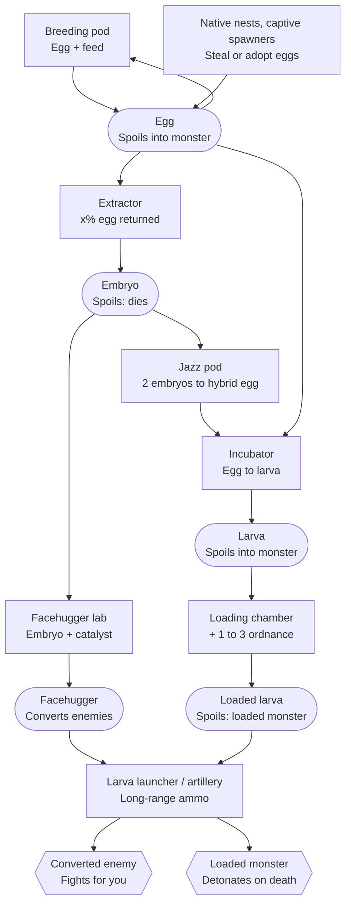
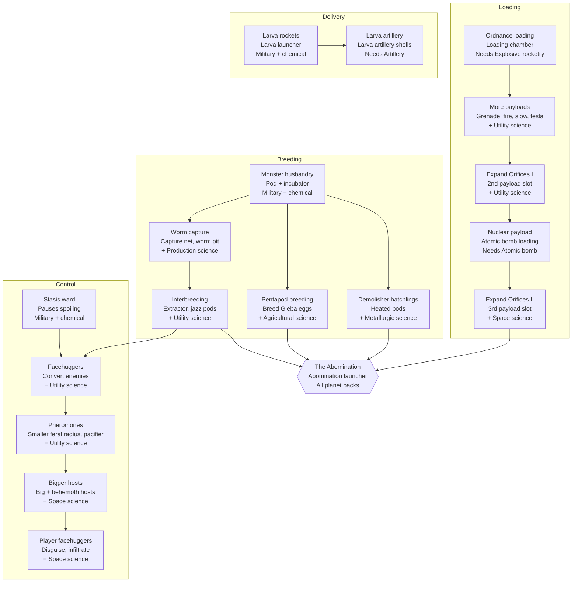

# Abominable Ordnance: Factorio mod design doc

11 Nov 2026 · @Mark

## Concept

You breed the planet's monsters in your base, stuff them with ordnance, and
fire them at the natives. A biter loaded with an explosive rocket blows up on
death. A pentapod loaded with a nuke becomes an atomic bomb with legs. Late
game, you crossbreed everything into one final Abomination.

The mod is PvE by default: loaded monsters fight native enemies. With a PvP
setting, players can fire them at other players' bases in multiplayer.

### Design pillars

- **Ordnance with legs.** Every monster is a delivery system. Its payload
  decides what happens while it lives and when it dies.
- **Dangerous to handle.** A loaded larva that spoils turns into its full
  monster on the spot, and a loaded monster goes feral when you stand too
  close. The factory has to keep larvae moving and monsters at a distance.
- **Biology as a production chain.** Breed, load and crossbreed are
  machines and recipes, so you can automate the whole thing.
- **Absurd on purpose.** Smooth jazz in the jazz pods, an "Expand
  Orifices" research, facehuggers. The tone is a joke, but the systems are
  played straight.

### Non-goals

- Full control of a monster by the player. A facehugger on a player swaps
  the character's skin and stats only (see [Facehuggers](#facehuggers)).
- Full-size demolishers as ammunition. The mod adds a small hatchling
  species instead.
- The Space Age rocket turret as a larva launcher. One larva launcher fires
  larvae in both modes.
- Payloads outside the table in [Ordnance loading](#ordnance-loading).

## Core loop

The loop runs from a captured egg to a detonation in enemy territory. Every
step after Capture is a machine or a recipe, so you can automate it.

1. **Capture.** Get eggs from native nests and, in Space Age, captive
   spawners and pentapod egg farms. Catch worms and demolisher hatchlings in
   the field.
2. **Breed.** Breeding pods turn eggs and feed into more eggs. An extractor
   turns one egg into an embryo, with an x% chance of an egg back.
3. **Load.** An incubator turns ten eggs into a larva. A loading chamber then
   fills the larva with one to three ordnance items. Only larvae can be
   loaded.
4. **Crossbreed (optional).** Jazz pods combine two embryos of different
   species into a hybrid egg, which goes to the incubator like any other
   egg.
5. **Store and ship.** Stasis wards pause the spoil timer on the way (see
   [Logistics and delivery](#logistics-and-delivery)).
6. **Fire.** The larva launcher and artillery fire loaded larvae as
   long-range ammo. The larva turns into its full monster where it lands.
7. **Detonate.** The monster attacks the area where it lands, applies its
   live effect (such as an acid trail), and triggers its payload on death.

## Lifecycle: eggs, embryos and larvae

Each stage has one job and its own risk: eggs keep the population going,
embryos carry genetics, and larvae are the ammunition. Risk rises from embryo
(safe) to egg and larva (they hatch when they spoil) to loaded larva
(explosive).

Eggs breed, embryos cross, larvae fly:

Rounded boxes are items, and square boxes are machines. The last box is a
live monster in the field.

The main chain is egg, incubator, larva, loading chamber, launcher. Embryos
branch off it for hybrids and facehuggers.

| Stage | Made by | Used for | When it spoils |
| --- | --- | --- | --- |
| Egg | Breeding pod (egg + feed), native nests, captive spawners (Space Age) | Breeding more eggs, extractor input, incubator input | Hatches a wild, unloaded, hostile monster |
| Embryo | Extractor: uses up one egg, with an x% chance of an egg back | Crossbreeding in jazz pods, the facehugger lab, shipping a species between planets | Dies. Safe to put on a rocket |
| Hybrid egg | Jazz pod: two embryos of different species | Incubator, or the Abomination fusion. It can't breed, so every hybrid needs a fresh cross | Hatches a wild hybrid |
| Larva | Incubator: ten eggs (see Open questions for hybrid eggs) | Loading chamber input | Becomes a wild, unloaded monster |
| Loaded larva | Loading chamber: larva + 1 to 3 ordnance | Larva rockets and artillery shells | Becomes its full loaded monster on the spot |
| Facehugger | Facehugger lab: embryo + catalyst | Converting enemies. The embryo's species decides what the host becomes | Dies |

The feed is monster chow, and spitters need spitter chow. A chemical plant
makes both. A stasis ward can hold any item in this table.

## Monsters

There are five breedable species. Four are vanilla enemy families. The
fifth, the demolisher hatchling, is the mod's small stand-in for the
demolisher. Each species has a base role that carries over into hybrids.

| Species | Planet | How you get it | Base role |
| --- | --- | --- | --- |
| Biter | Nauvis | Nest loot and the breeding pod. In Space Age also the captive biter spawner | Fast, cheap melee carrier |
| Spitter | Nauvis | Nest loot and the breeding pod | Ranged. Its payload lands at the target |
| Worm | Nauvis | Capture net on a small worm, then a worm pit, the worm's breeding pod | Stationary. It roots where it lands and fights as a worm turret |
| Pentapod | Gleba | Space Age's own pentapod eggs and their biochamber recipe | Tanky, long reach, crosses obstacles |
| Demolisher hatchling | Vulcanus | Capture net on a hatchling near demolisher territory | Heavy, slow, huge payload capacity |

Full-size demolishers are too large to launch, so the mod adds a small
"hatchling" species. A hatchling is not a larva: larvae are the ammo stage of
every species. Hatchling eggs breed only in heated pods. The heat comes from
Vulcanus lava, or from heating towers or a nuclear reactor.

**Without Space Age**, the mod has biters, spitters and worms, every payload
except tesla ammo, the Nauvis hybrids (Crawling worm and Spitworm),
facehuggers and the stasis ward. Pentapods, hatchlings, their hybrids and the
Abomination need Space Age.

## Ordnance loading

Each payload gives a live effect while the monster lives and a death effect
when it dies. Ordnance goes into larvae only. The payloads are the nine items
in this table.

| Payload item | While alive | On death |
| --- | --- | --- |
| Explosive rocket | None | Rocket-sized explosion |
| Grenade | None | Grenade blast |
| Cluster grenade | None | Cluster scatter |
| Sulfuric acid (barrel) | Acid trail: small acid puddles under it | Large acid pool |
| Poison capsule | Small poison aura | Poison cloud |
| Slowdown capsule | Slows nearby enemies | Slowdown burst |
| Flamethrower ammo | Leaves a fire trail | Fire burst |
| Atomic bomb | Glows, moves slowly | Nuclear explosion |
| Tesla ammo (Space Age) | Arcs to nearby enemies | Chain-lightning burst |

**Expand Orifices.** By default a monster holds one payload. The Expand
Orifices I research adds a second slot, and Expand Orifices II adds a third.
Live effects run side by side and death effects fire together.

Balance rules for stacking:

- Only one atomic bomb per monster, whatever the slot count.
- Each extra slot raises the feral radius (see
  [Feral behaviour and risks](#feral-behaviour-and-risks)) and the loading
  time.
- Slot caps: biters, spitters and worms max 2. Pentapods, hatchlings and the
  Abomination max 3. A hybrid takes the higher cap of its parents. No
  monster ever holds more than 3.

## Crossbreeding

Jazz pods combine two embryos of different species into a hybrid egg that
keeps one trait from each parent. Hybrid eggs can't breed: each one needs a
fresh cross, then goes through the incubator and loading chamber like any
other egg. We agreed on the
benefits below as starting points. Test games will tune the numbers.

| Hybrid | Parents | Benefit |
| --- | --- | --- |
| Skitterpod | Biter × pentapod | Fast and long-legged. Walks over walls and cliffs |
| Crawling worm | Biter × worm | A worm that walks toward enemies, then roots and fires |
| Spitpod | Spitter × pentapod | Ranged attack with long reach. Its payload hits the target directly |
| Spitworm | Spitter × worm | Artillery-range acid spit from a rooted position |
| Magma biter | Biter × demolisher hatchling | Leaves a lava trail and is fire-immune |
| Lavapod | Pentapod × demolisher hatchling | Very tanky. Holds one more payload than the research allows, up to the cap of 3 |
| Burrower | Worm × demolisher hatchling | Tunnels underground, surfaces under the target |

Biter × spitter has no hybrid, because the two species are too alike. The
other pairs with no hybrid can follow later.

**Jazz pods.** Jazz pods play a smooth jazz loop when you stand within 5
tiles. The sound radius is short, so a full breeding hall turns into a
lounge, not a wall of noise. A setting turns it off.

**The Abomination.** The final form fuses all five species. A jazz pod fuses
three hybrid eggs into one Abomination egg: a Magma biter, a Spitworm and a
Lavapod. Together these three hybrids cover all five species. The fusion also
needs a final research. The Abomination egg goes through the incubator and
the loading chamber like any hybrid egg.

The Abomination has 3 payload slots and the traits of its three hybrids: a
lava trail with fire immunity, artillery-range acid spit, and huge health.
It is too big for the larva launcher or an artillery shell, so it fires only
from the Abomination launcher. It goes feral like any loaded monster, but
its feral radius is the largest in the mod (see
[Feral behaviour and risks](#feral-behaviour-and-risks)).

## Facehuggers

Facehuggers convert enemy monsters in the field into your species. They are
made in a facehugger lab from an embryo plus a catalyst. The embryo's species
decides what the host turns into.

- **Delivery.** Fired as a larva rocket like a loaded larva, or thrown by
  hand as a capsule.
- **Effect.** The facehugger latches on to the nearest enemy. After 5
  seconds the host turns into the target species and fights on your side. If
  the host dies first, the conversion fails.
- **Limits.** At first, a facehugger converts only small and medium enemies.
  Big and behemoth hosts need a later research. A facehugger can't convert a
  demolisher.
- **Converted units carry no payload.** Their feral radius depends on
  their size only. They fight until they die. They go
  feral when you come too close or when they stay idle, but never by the
  unstable rule, which needs a payload.

**On players: both a bonus and a punishment.** The simplest version swaps the
player's character for a monster-skinned character with different speed and
health. You get the bonus by throwing a facehugger capsule at your own feet.
Natives treat a transformed player as one of their own, so you can walk into
a nest and steal eggs. Turning back (healing or eating a fish) sets up a
surprise attack from inside their base. An enemy facehugger landing on you is
the punishment version: you lose your weapons until you turn back.

**Pacifier facehugger.** A facehugger variant that re-tames a feral monster
instead of converting an enemy. The point is to save the payload: a tamed
feral nuke-pentapod is still a nuke-pentapod on your side.

## Feral behaviour and risks

A loaded monster starts on your side: it fights the natives and leaves your
buildings alone. A loaded
monster goes feral in three ways:

- **Too close.** A player stands inside its feral radius.
- **Idle.** It has had nothing to fight for 5 minutes, for example after it
  cleared a nest or landed on a planet with no natives.
- **Unstable.** Every minute it has a small chance to go feral, and the
  chance grows with each payload it carries.

Feral monsters attack the nearest target, including you and your buildings,
and their payload still goes off when they die. A feral monster joins its own
force, which is hostile to everyone, so the natives fight it too.

- **Feral radius.** Grows with payload count and monster size. For a
  one-slot biter it is around 5 tiles. For the Abomination it is around 20.
- **Spoiled larvae.** A loaded larva that spoils outside a stasis ward becomes
  its full monster at once, already loaded. A nuke larva that spoils on a belt
  is a serious risk. Spoiled eggs hatch a wild, unloaded
  monster. Spoiled embryos die.
- **Calming research.** Pheromone dampeners shrink the feral radius by a
  percentage per level. They never remove it entirely.
- **Balance levers.** Breeding time, feed cost, spoil time, payload cap per
  species, and the one-nuke-per-monster rule.

Feral monsters can be re-tamed with a pacifier facehugger (see
[Facehuggers](#facehuggers)), which brings them back with their payload
intact.

## Logistics and delivery

The stasis ward keeps lifecycle items from spoiling on the way. The larva
launcher and artillery fire loaded larvae.

- **Stasis ward.** Each lifecycle item has a warded version with a very
  long spoil time, for example "warded biter egg". An assembler packs an item
  into its warded version, and another recipe unpacks it. A recipe's output
  keeps its ingredients' freshness, so the spoil timer continues where it
  stopped. Warded items stack and travel by belt, train or rocket.
- **Larva launcher.** A new turret that fires larva rockets: loaded larvae
  and facehuggers packed into long-range rocket ammo. The mod uses this one
  launcher with and without Space Age. It does not use the Space Age rocket
  turret.
- **Artillery shells.** Loaded larvae packed into an artillery shell for long
  range. Every species except the Abomination fits.
- **Abomination launcher.** A large dedicated launcher for the final form,
  with artillery range.

## Research tree

The four version 1 techs start four branches. The Breeding and Loading
branches meet at the Abomination. Science packs are proposals: Nauvis packs
for the core of each branch, planet packs for the planet species. The planet
techs sit on side branches, so the core of every branch works without Space
Age.

Research tree, 4 branches and 18 techs. The top row is version 1:

The Abomination needs Interbreeding, Pentapod breeding, Demolisher
hatchlings and Expand Orifices II. The Delivery and Control branches are
side paths. They make the Abomination safer and easier to use, but they
don't gate it.

## Feature roadmap

Version 1 is Nauvis-only: biters and spitters, three payloads, one launcher.
It proves the core loop before adding planets. Ticked items are in the mod.

### Version 1 (MVP)

- [x] Breeding pod (eggs) and incubator (larvae) for biters and spitters
- [x] Loading chamber with three payloads: explosive rocket, sulfuric acid,
  poison capsule
- [x] One generated item for each species × payload larva
- [x] Death effects for all three payloads, plus the acid trail while alive
- [ ] Larva rockets and the larva launcher. The monster appears where it
  lands.
- [ ] Feral behaviour: monsters attack everything when a player comes too
  close, when they stay idle, or by a chance per payload
- [x] Spoil outcomes: eggs hatch wild, loaded larvae become loaded monsters
- [ ] Stasis ward that pauses and resumes the spoil timer
- [ ] First four research techs (Monster husbandry and Ordnance loading are
  in the mod, Larva rockets and Stasis ward are not)
- [ ] Runs on vanilla Factorio 2.1 and with Space Age

### Version 2

- [ ] Expand Orifices I and II (multi-slot loading)
- [ ] Worms and pentapods, plus the remaining payloads (grenades, slowdown,
  flamethrower, tesla, atomic bomb)
- [ ] Artillery shells for loaded larvae
- [ ] Extractor, embryos, jazz pods and the first hybrids
- [ ] Facehuggers on enemies

### Version 3

- [ ] Demolisher hatchlings and heated pods (lava, heating towers, reactors)
- [ ] Remaining hybrids and the Abomination with its launcher
- [ ] Pheromone dampener research and the pacifier facehugger
- [ ] Bigger hosts, and facehuggers on players (disguise, infiltrate, turn
  back)
- [ ] PvP setting for multiplayer

## Technical notes (Factorio 2.1 / Space Age)

Ordinary prototypes plus a small control script can do most of the mod. The
hard parts are prototype count, demolishers and the player transformation.

- **Loaded larvae as items.** Version 1 generates one item per species ×
  payload in `data.lua`. Loaded monsters are vanilla units that the script
  tracks, so version 1 generates no entity prototypes for them. Hybrids and
  hatchlings need their own unit prototypes.
- **Spoiling and hatching.** Use the 2.1 spoilage system (`spoil_ticks`
  plus a spoil trigger). The trigger runs a `script` effect, and a core
  module picks the unit from the enemy evolution. Without Space Age, the
  mod enables spoilage itself with `"spoiling_required": true` in its
  info.json.
- **Launching.** Larva rockets and artillery shells whose projectile runs
  the loaded larva's `script` effect on impact. The script then spawns the
  loaded unit at the landing spot and records its payload. A `create-entity`
  trigger cannot record the payload.
- **Live and death effects.** Track loaded units in `storage`. Live effects
  run from `on_nth_tick`. Death effects come from `on_entity_died`, which
  spawns the matching explosion or cloud.
- **Forces.** Loaded monsters join an allied force that is hostile to the
  natives. Going feral moves the unit to a separate feral force that is
  hostile to everyone. With PvP on, each player force gets its own allied
  monster force.
- **Feral check.** Every 30 ticks as a starting value, search around each
  player with the largest feral radius and check the matches against
  `storage`.
- **Jazz.** A `working_sound` on the jazz pod with a short
  `audible_distance_modifier`.
- **Demolisher hatchlings.** A full demolisher is a chain of linked
  entities, so the hatchling should be a new, ordinary unit with demolisher
  graphics.
- **Facehugger on players.** Create a new character entity with a
  monster-skinned prototype, move the inventory over, and attach it to the
  player. Reverse it on healing, a fish, or death.
- **Extractor egg return.** A recipe result with a `probability` of x gives
  the chance of getting an egg back.
- **Stasis ward.** Plain recipes. A recipe result takes its freshness from
  the ingredients unless the product sets `always_fresh`, so packing and
  unpacking keep the spoil progress with no script.

### Technical risks

- **Item count.** With one slot, 13 loadable kinds (5 species, 7 hybrids and
  the Abomination) × 9 payloads make about 117 loaded-larva items. Multiple
  slots make thousands. The version 2 spec must choose between a short list
  of allowed combinations and one `item-with-tags` per species. Tagged items
  don't stack, and normal recipes can't make them.
- **Ammo count.** Each loaded larva may also
  need a warded version, a larva rocket and an artillery shell. That
  multiplies the count by up to 4, unless the rocket and shell carry the
  larva in another way.
- **Hybrid mechanics.** The engine has no unit that walks over walls,
  tunnels, or turns from a unit into a turret. The Skitterpod, Burrower and
  Crawling worm need script work or a simpler trait. In Space Age, pentapods
  are `spider-unit` entities, not plain units.
- **Feral check cost.** Checking every unit against every player grows with
  units × players. A search around each player grows with players only.
- **`storage` cleanup.** A unit can vanish without `on_entity_died`, for
  example when a script or another mod destroys it. The mod registers each
  unit with `script.register_on_object_destroyed` and removes its record
  then.
- **Old saves.** A change to `storage` or to the techs needs a migration or
  `on_configuration_changed` code, so an old save keeps working.
- **Multiplayer.** All state lives in `storage`, and the script uses only
  the game's own random generator, so every client computes the same game.
- **Force limit.** Factorio allows 64 forces. With PvP, each player force
  adds an allied monster force, and the mod adds one feral force.

## Decisions and rejected alternatives

Each slice spec lists its own alternatives. These are the decisions that
shape the whole mod.

| Decision | Rejected alternative | Reason |
| --- | --- | --- |
| One larva launcher in both modes | Space Age rocket turret, or gun-turret ammo | One delivery path halves the test matrix |
| Spawn loaded monsters from a `script` effect | A `create-entity` trigger | Only the script can record the payload |
| Hatchlings as plain units | Linked-chain demolishers | A chain of linked entities is too large to launch |
| Stasis ward from plain recipes | A script-managed container or tags | Recipes keep freshness and need no script, and the warded items stack |
| One item per species × payload in version 1 | One `item-with-tags` per species | Tagged items don't stack. Version 2 decides again for multiple slots |

## Open questions

Answered:

- [x] Final hybrid benefits: are the proposals in Crossbreeding the right
  direction? As proposed.
- [x] Facehuggers on players: a bonus, a punishment, or both? Both.
- [x] Can feral monsters be re-tamed, or are they lost for good? Yes, through
  the pacifier facehugger.
- [x] Is the mod Space Age-only, or should a Nauvis-only mode work without
  the expansion? Both vanilla and Space Age.
- [x] Mod name: is "Abominable Ordnance" only a working title? The name
  stays.
- [x] Jazz: commission or find a royalty-free track (license must allow
  redistribution in a mod)? Sascha Ende's "Sexy Scene Instrumentals"
  volumes 4, 9 and 10 (CC BY 4.0), one track per machine. The music starts
  with the jazz pods in version 2.
- [x] Loot eggs: nest loot is 1 to 3 eggs, below the ten eggs a larva needs.
  Should left-behind loot eggs hatch? Every left-behind loot pile hatches
  one monster.
- [x] Vanilla launcher: a new building, or long-range ammo for the gun
  turret? A new building, the larva launcher, used in both modes.

Open:

- [ ] Hybrid larvae: how many hybrid eggs make one larva? Ten makes a hybrid
  larva cost 20 embryos. One makes it cheaper than a plain larva.
- [ ] Spoiled loaded larvae: does the monster start on your side, as
  slice 2 builds it, or start feral?
- [ ] Captive spawners: do they give the mod's own biter egg or Space Age's
  `biter-egg`?
- [ ] Captured worms and hatchlings: how does a caught animal become the
  first egg?
- [ ] Shipped embryos: which recipe turns an embryo back into an egg on
  another planet?
- [ ] Warded items: what does a warded item become when its own long spoil
  timer runs out?
- [ ] Extractor egg-return chance: what value for x (20 to 30% as a
  starting point)?
- [ ] PvP rules: can loaded monsters be re-tamed by the enemy player, and do
  facehuggers work on enemy players?
- [ ] Facehugger catalyst: which item, and does it differ per planet?
