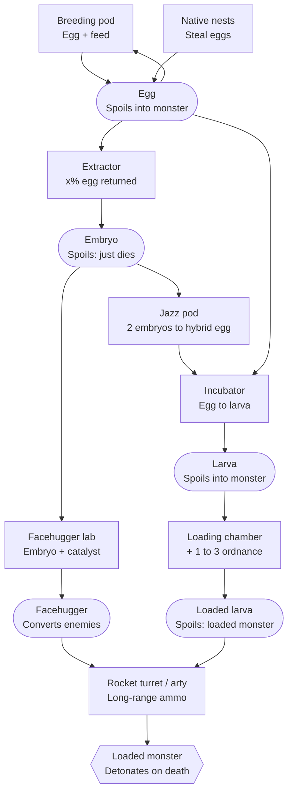
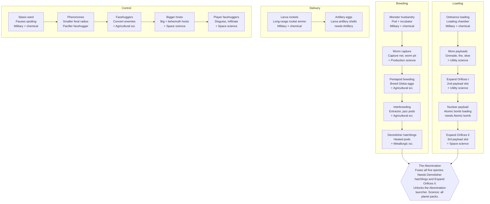

# Abominable Ordnance: Factorio mod design doc

Nov 11, 2026 · @Mark

## Concept

You breed the planet's monsters in your base, stuff them with ordnance, and
fire them at the natives. A biter loaded with an explosive rocket blows up on
death. A pentapod loaded with a nuke becomes an atomic bomb with legs. Late
game, you crossbreed everything into one final Abomination.

The mod is PvE by default: loaded monsters fight native enemies. With a PvP
setting, players can fire them at other players' bases in multiplayer.

### Design pillars

- **Ordnance with legs.** Every monster is a delivery system. Its payload
  decides what happens while it lives and when it dies.
- **Dangerous to handle.** Loaded monsters go feral when you stand too close,
  and a spoiled loaded larva turns into its full monster on the spot. The
  factory has to keep them at a distance.
- **Biology as a production chain.** Capture, breed, load and crossbreed are
  machines and recipes, so you can automate the whole thing.
- **Absurd on purpose.** Smooth jazz in the jazz pods, an "Expand
  Orifices" research, facehuggers. The tone is a joke, but the systems are
  played straight.

## Core loop

The loop runs from a captured egg to a detonation in enemy territory. Every
step is a machine, so you can automate it.

1. **Capture.** Get eggs from captive spawners, pentapod egg farms, worms and
   demolisher hatchlings caught in the field, or steal them from native nests.
2. **Breed.** Breeding pods turn eggs and feed into more eggs. An extractor
   turns one egg into an embryo, with an x% chance of an egg back.
3. **Load.** An incubator turns an egg into a larva. A loading chamber then
   fills the larva with one to three ordnance items. Only larvae can be
   loaded.
4. **Crossbreed (optional).** Jazz pods combine two embryos of different
   species into a hybrid egg, which goes to the incubator like any other egg.
5. **Store and ship.** Stasis wards pause the spoil timer of eggs, embryos and
   larvae on the way. The timer resumes where it stopped.
6. **Fire.** Rocket turrets and artillery fire loaded larvae as special
   long-range ammo. The larva turns into its full monster where it lands.
7. **Detonate.** The monster fights while it lives, applies its live effect
   (such as an acid cloud), and triggers its payload on death.

## Lifecycle: eggs, embryos and larvae

Each stage has one job and its own risk: eggs keep the population going,
embryos carry genetics, and larvae are the ammunition. Risk rises from embryo
(safe) to egg (risky) to loaded larva (explosive).

Eggs breed, embryos cross, larvae fly:

Rounded boxes are items, and square boxes are machines. The last box is a
live monster in the field.

The main chain runs down the middle: egg, incubator, larva, loading chamber,
launcher. Embryos branch off to the left for hybrids and facehuggers.

| Stage | Made by | Used for | When it spoils |
| --- | --- | --- | --- |
| Egg | Breeding pod (egg + feed), captive spawners, stolen from native nests | Breeding more eggs; extractor input; incubator input | Hatches a wild, unloaded, hostile monster |
| Embryo | Extractor: uses up one egg, with an x% chance of an egg back | Crossbreeding in jazz pods; facehugger lab; shipping a species between planets | Dies (maybe into biomass); safe to put on a rocket |
| Hybrid egg | Jazz pod: two embryos of different species | Incubator only; it can't breed, so every hybrid needs a fresh cross | Hatches a wild hybrid |
| Larva | Incubator: one egg | Loading chamber input | Becomes a wild, unloaded monster |
| Loaded larva | Loading chamber: larva + 1 to 3 ordnance | Long-range rocket ammo and artillery shells | Becomes its full loaded monster on the spot |
| Facehugger | Facehugger lab: embryo + catalyst | Converting enemies; the embryo's species decides what the host becomes | Dies |

The stasis ward pauses the spoil timer of any of these items. When you unpack
the item, the timer resumes where it stopped.

## Monsters

There are five breedable species, one per vanilla enemy family. Each has a
base role that carries over into hybrids.

| Species | Planet | How you get it | Base role |
| --- | --- | --- | --- |
| Biter | Nauvis | Captive biter spawner (vanilla Space Age) | Fast, cheap melee carrier |
| Spitter | Nauvis | Captive spawner with a spitter-feed recipe | Ranged; payload lands at the target |
| Worm | Nauvis | Capture net on a small worm, then a worm pit | Stationary; becomes a turret where it lands |
| Pentapod | Gleba | Pentapod eggs from Gleba nests | Tanky, long reach, crosses obstacles |
| Demolisher hatchling | Vulcanus | Capture a hatchling near a demolisher territory | Heavy, slow, huge payload capacity |

Full-size demolishers are too large to launch, so the mod adds a small
"hatchling" species. A hatchling is not a larva: larvae are the ammo stage of
every species. Hatchling eggs breed only in heated pods. The heat comes from
Vulcanus lava, or from heating towers or a nuclear reactor. Without Space Age,
only the three Nauvis species are available.

## Ordnance loading

Each payload gives a live effect while the monster lives and a death effect
when it dies. Ordnance goes into larvae only, and any existing ammo or capsule
can serve as a payload.

| Payload item | While alive | On death |
| --- | --- | --- |
| Explosive rocket | None | Rocket-sized explosion |
| Grenade / cluster grenade | None | Grenade blast / cluster scatter |
| Sulfuric acid (barrel) | Poison cloud that follows it | Large acid pool |
| Poison capsule | Small poison aura | Poison cloud |
| Slowdown capsule | Slows nearby enemies | Slowdown burst |
| Flamethrower ammo | Leaves a fire trail | Fire burst |
| Atomic bomb | Glows, moves slowly | Nuclear explosion |
| Tesla ammo (Space Age) | Arcs to nearby enemies | Chain-lightning burst |

**Expand Orifices.** By default a monster holds one payload. The Expand
Orifices research adds a second slot, and Expand Orifices II adds a third.
Live effects run side by side and death effects fire together.

Balance rules for stacking:

- Only one atomic bomb per monster, whatever the slot count.
- Each extra slot raises the feral radius (see Risks) and the loading time.
- Larger species get more slots: biters max 2, pentapods and hatchlings max 3.

## Crossbreeding

Jazz pods combine two embryos of different species into a hybrid egg that
keeps one trait from each parent. Hybrid eggs can't breed: each one needs a
fresh cross, then goes through the incubator and loading chamber like any
other egg. All benefits below are first proposals. They still need tuning.

| Hybrid | Parents | Benefit (proposal) |
| --- | --- | --- |
| Skitterpod | Biter × pentapod | Fast and long-legged; walks over walls and cliffs |
| Crawling worm | Biter × worm | A worm that walks toward enemies, then roots and fires |
| Spitpod | Spitter × pentapod | Ranged attack with long reach; payload hits the target directly |
| Spitworm | Spitter × worm | Artillery-range acid spit from a rooted position |
| Magma biter | Biter × demolisher hatchling | Leaves a lava trail; fire-immune |
| Lavapod | Pentapod × demolisher hatchling | Very tanky; +1 payload slot |
| Burrower | Worm × demolisher hatchling | Tunnels underground, surfaces under the target |

**Jazz pods.** Interbreeding pods play a smooth jazz loop when you stand
within a few tiles. The sound radius is short, so a full breeding hall turns
into a lounge, not a wall of noise. A setting turns it off.

**The Abomination.** The final form fuses all five species. It needs a hybrid
from every planet and a final research. It has 3 payload slots, every parent
trait at once (lava trail, ranged spit, wall-walking, tunnelling), and huge
health. It is too big for a turret and fires only from artillery or a
dedicated launcher. When it goes feral it attacks everything, including your
base, so it is the riskiest thing in the mod.

## Facehuggers

Facehuggers convert enemy monsters in the field into your species. They are
made in a facehugger lab from an embryo plus a catalyst. The embryo's species
decides what the host turns into.

- **Delivery.** Fired as long-range rocket ammo like a loaded larva, or thrown
  by hand as a capsule.
- **Effect.** The facehugger latches on to the nearest enemy. After a few
  seconds the host turns into the target species and fights on your side. If
  the host dies first, the conversion fails.
- **Limits.** At first, a facehugger converts only small and medium enemies.
  Big and behemoth hosts need a later research. A facehugger can't convert a
  demolisher.
- **Converted units are temporary.** They live until they die, and they go
  feral like any other loaded monster.

**On players: both a bonus and a punishment.** The simplest version swaps the
player's character for a monster-skinned character with different speed and
health. Natives treat a transformed player as one of their own, so you can
walk into a nest and steal eggs. Turning back (healing or eating a fish) sets
up a surprise attack from inside their base. An enemy facehugger landing on
you is the punishment version: you lose your weapons until you turn back.
Fully controlling a biter is much more work and is left for later.

**Pacifier facehugger.** A facehugger variant that re-tames a feral monster
instead of converting an enemy. The point is to save the payload: a tamed
feral nuke-pentapod is still a nuke-pentapod on your side.

## Feral behaviour and risks

A loaded monster goes feral when a player stands inside its feral radius.
Feral monsters attack the nearest target, including you and your buildings,
and their payload still goes off when they die.

- **Feral radius.** Grows with payload count and monster size. For a
  one-slot biter it is around 5 tiles. For the Abomination it is around 20.
- **Spoiled larvae.** A loaded larva that spoils outside a stasis ward becomes
  its full monster at once, already loaded. A nuke larva spoiling on a belt is
  a real risk. Spoiled eggs hatch a wild, unloaded monster. Spoiled embryos
  just die.
- **Calming research.** Pheromone dampeners shrink the feral radius by a
  percentage per level. They never remove it entirely.
- **Balance levers.** Breeding time, feed cost, spoil time, payload cap per
  species, and the one-nuke-per-monster rule.

Feral monsters can be re-tamed with a pacifier facehugger (see Facehuggers),
which brings them back with their payload intact.

## Logistics and delivery

The stasis ward keeps eggs from spoiling, and the launchers turn eggs into
ammunition.

- **Stasis ward.** A crafted item that holds one egg, embryo or larva. Packing
  pauses the item's spoil timer. Unpacking restores the item, and its spoil
  timer continues where it stopped. Packing and unpacking happen in an
  assembler, so warded eggs can travel by belt, train or rocket.
- **Long-range rocket ammo.** No new turret: loaded larvae and facehuggers are
  packed into rocket ammo that extends the rocket turret's range. The rocket
  turret only exists in Space Age, so in vanilla the mod adds a simple
  launcher that takes the same ammo.
- **Artillery shells.** Loaded larvae packed into an artillery shell for long
  range. Every species except the Abomination fits.
- **Abomination launcher.** A large dedicated launcher for the final form,
  with artillery range.

## Research tree

The four version 1 techs open four branches, and the Breeding and Loading
branches meet at the Abomination. Science packs are proposals: Nauvis packs
early, planet packs for the matching species.

Four research branches converge on the Abomination. The top row is version 1.
Each box needs the one above it.

Research tree · 4 branches, 18 techs.

The Delivery and Control branches are side paths. They make the Abomination
safer and easier to use, but they don't gate it.

## Version 1 feature list

Version 1 is Nauvis-only: biters and spitters, three payloads, one launcher.
It proves the core loop before adding planets.

### Version 1 (MVP)

- [ ] Breeding pod (eggs) and incubator (larvae) for biters and spitters
- [ ] Loading chamber with three payloads: explosive rocket, sulfuric acid,
  poison capsule
- [ ] Generated item and entity prototypes for each species × payload larva
- [ ] Death effects for all three payloads, plus the acid poison cloud while
  alive
- [ ] Long-range rocket ammo that fires loaded larvae. The monster appears
  where it lands. Vanilla gets a simple launcher.
- [ ] Feral behaviour: monsters attack players inside a fixed radius
- [ ] Spoil outcomes: eggs hatch wild, loaded larvae become loaded monsters
- [ ] Stasis ward that pauses and resumes the spoil timer
- [ ] First four research techs (Monster husbandry, Ordnance loading, Larva
  rockets, Stasis ward)
- [ ] Runs on vanilla Factorio 2.1 and with Space Age

### Version 2

- [ ] Expand Orifices I and II (multi-slot loading)
- [ ] Worms and pentapods, plus the remaining payloads (grenades, slowdown,
  flamethrower, tesla, atomic bomb)
- [ ] Artillery shells for loaded eggs
- [ ] Extractor, embryos, jazz pods and the first hybrids
- [ ] Facehuggers on enemies, plus the pacifier facehugger

### Version 3

- [ ] Demolisher hatchlings and heated pods (lava, heating towers, reactors)
- [ ] Remaining hybrids and the Abomination with its launcher
- [ ] Pheromone dampener research
- [ ] Facehuggers on players (disguise, infiltrate, turn back)
- [ ] PvP setting for multiplayer

## Technical notes (Factorio 2.1 / Space Age)

Ordinary prototypes plus a small control script can do most of the mod. The
hard parts are prototype count, demolishers and the player transformation.

- **Loaded larvae as items.** Generate one item per species × payload in
  `data-final-fixes`. With one slot that is 5 × 8 = 40 items. With three
  slots it grows to hundreds. Two options: limit which combinations are
  allowed, or use a single `item-with-tags` per species and have the script
  record the payloads in the tags. Tags don't stack, and normal recipes
  can't make them, so the first option is simpler for version 1.
- **Spoiling and hatching.** Use the 2.1 spoilage system (`spoil_ticks` plus a
  spoil trigger that creates the unit), the same way Space Age biter eggs
  hatch. Without Space Age, the mod turns spoilage on itself through the
  `spoiling` feature flag in its info.json.
- **Launching.** Turret ammo and artillery shells whose projectile has a
  `create-entity` trigger on impact, spawning the loaded unit at the landing
  spot.
- **Live and death effects.** Track loaded units in `storage`. Live effects
  run from `on_nth_tick`. Death effects come from `on_entity_died`, which
  spawns the matching explosion or cloud.
- **Forces.** Loaded monsters join an allied force that is hostile to the
  natives. Going feral moves the unit to a separate feral force that is
  hostile to everyone. With PvP on, each player force gets its own allied
  monster force.
- **Feral check.** Every 30 ticks or so, compare tracked units against player
  positions and the feral radius.
- **Jazz.** A `working_sound` on the interbreeding pod with a short
  `audible_distance_modifier`.
- **Demolisher hatchlings.** A full demolisher is a chain of linked
  entities, so the hatchling should be a new, ordinary unit with demolisher
  graphics.
- **Facehugger on players.** Create a new character entity with a
  monster-skinned prototype, move the inventory over, and attach it to the
  player. Reverse it on timeout, death or cure.
- **Extractor egg return.** A recipe result with a `probability` of x gives
  the chance of getting an egg back.
- **Stasis ward.** A normal recipe always makes a fresh item, so the script
  must do the packing and unpacking. On packing, it reads the item's spoil
  progress and stores it in the ward's tags. On unpacking, it writes the
  progress back.

## Open questions

The ticked questions have answers:

- Hybrid benefits: as proposed.
- Facehuggers on players: both a bonus and a punishment.
- Re-taming: through the pacifier facehugger.
- Support: both vanilla and Space Age.
- The name stays.
- Jazz: Sascha Ende's "Sexy Scene Instrumentals" volumes 4, 9 and 10
  (CC BY 4.0), one track per machine. The music starts with the jazz pods
  in version 2.

- [x] ~~Final hybrid benefits: are the proposals in Crossbreeding the right
  direction?~~
- [x] ~~Facehuggers on players: a bonus, a punishment, or both?~~
- [x] ~~Can feral monsters be re-tamed, or are they lost for good?~~
- [x] ~~Is the mod Space Age-only, or should a Nauvis-only mode work without
  the expansion?~~
- [x] ~~Mod name: "Abominable Ordnance" is a working title.~~
- [x] ~~Jazz: commission or find a royalty-free track (license must allow
  redistribution in a mod).~~
- [ ] Extractor egg-return chance: what value for x (20 to 30% as a
  starting point)?
- [ ] PvP rules: can loaded monsters be re-tamed by the enemy player, and do
  facehuggers work on enemy players?
- [ ] Facehugger catalyst: which item, and does it differ per planet?
- [ ] Vanilla launcher: a new building, or long-range ammo for the gun turret?
